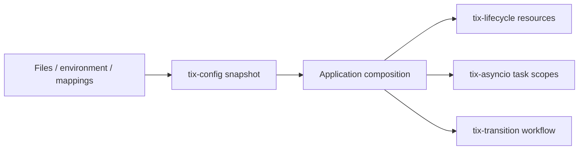

# Tix infrastructure

Four independently installable, typed Python 3.11+ packages. They share development
tooling, not runtime state or cross-package dependencies.

| Distribution / import | Purpose | Runtime dependencies |
| --- | --- | --- |
| [tix-config](tix-config/README.md) / `tix_config` | Layered local config, immutable versions, validation and atomic reload | None; optional PyYAML |
| [tix-asyncio](tix-asyncio/README.md) / `tix_asyncio` | Bounded task ownership, worker pools, retries, singleflight, cancellation | AnyIO |
| [tix-transition](tix-transition/README.md) / `tix_transition` | Validated reusable FSM definitions, sync/async execution, checkpoints | transitions, AnyIO |
| [tix-lifecycle](tix-lifecycle/README.md) / `tix_lifecycle` | Dependency graph startup, rollback, release, health and process adapters | AnyIO |

Read the [architecture plan and reference research](docs/architecture.md) for the
contracts, inspiration from Python/Rust/Go libraries, extension boundaries and
deliberately deferred features. The initial repository had empty package directories;
this is a new `0.1.0` API, not a backwards-compatible upgrade of an existing library.

## Development

```sh
uv sync --all-packages
uv run pytest
uv run ruff check .
uv run ruff format --check .
uv run python scripts/typecheck.py
uv build --all-packages
uv run python scripts/check_wheels.py
uv run python examples/service.py
```

`uv.lock` records the shared dependency resolution. Each package has its own build
metadata and can be installed directly from its directory (`pip install ./tix-config`)
or from a built wheel. No package has been published by this change.

The type-check script runs strict mypy with the same package-name mappings as the
build metadata, keeping `src/asyncio` distinct from the standard-library module.

CI runs tests, lint, typing, the composition example and builds on Windows and Linux
with Python 3.11–3.14. Async utilities and lifecycle tests exercise both asyncio and
Trio. The asynchronous FSM uses upstream `AsyncMachine` and requires asyncio.
See the [validation record](docs/validation.md) for locally executed checks and
platform limitations.

## Composition

The application owns the dependency wiring:



The [runnable example](examples/service.py) loads and validates settings, starts a
resource graph, processes bounded concurrent work, advances a workflow and releases
resources. It needs no database, network service, or credentials. Task scopes finish
before their resource-owning lifecycle scopes exit.

## Performance

Hot configuration reads use captured immutable snapshots. Task admission and worker
pools bound active work. FSM dispatch indexes events and source states. Lifecycle
graphs compile in O(V + E), and execution uses bounded workers per dependency layer.
History defaults to disabled; managers release completed task handles immediately.

Run the [local benchmark suite](benchmarks/README.md) to measure these paths on your
machine. Measurements are baselines, not claims of superiority to the reference
libraries or guarantees about application workloads.
